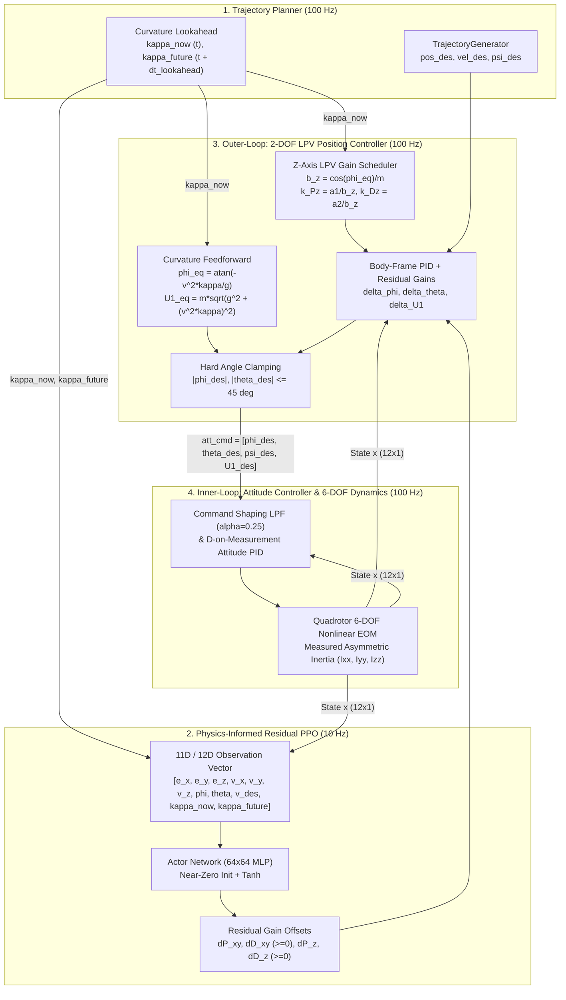

# 2026학년도 학사학위논문(종합설계보고서)

- **논문 제목**: Physics-Informed Residual Reinforcement Learning for Agile Quadrotor Trajectory Tracking  
  *(물리 정보 기반 잔차 강화학습을 이용한 쿼드로터 고속 궤적 추종 제어)*
- **소속**: 중앙대학교 전자전기공학부
- **지도교수**: 최형태 교수님
- **제출자**: 박세현 (20235668)
- **제출일**: 2026. 11. 18.

---

## Abstract

High-speed quadrotors experience significant nonlinearities and time-scale separation issues during sharp maneuvers, which degrade the tracking performance of traditional linear PID controllers. This study proposes a hybrid control architecture combining Linear Parameter-Varying (LPV) gain scheduling and a residual Proximal Policy Optimization (PPO) reinforcement learning agent. The LPV controller, scheduled by velocity and trajectory curvature, handles the primary nonlinear dynamics and ensures global nominal stability. The residual PPO agent compensates for model uncertainties, transient response delays, and high-curvature entry overshoots by dynamically modulating PD feedback gains ($\Delta P_{xy}, \Delta D_{xy}, \Delta P_z, \Delta D_z$) within bounded stability limits. Furthermore, to address the spatial overskipping issue of fixed-time curvature lookahead ($\Delta t = 0.5\text{ s}$) in tight hairpin turns, we investigate a speed-inverse spatial lookahead strategy (**Option 1**, $\Delta t = L / v_{\text{des}}, L = 2.0\text{ m}$, 11D) and a dual spatial-temporal lookahead strategy (**Option 2**, $\Delta t_1 = L / v_{\text{des}}$ and $\Delta t_2 = 0.5\text{ s}$, 12D). Simulations were conducted using high-fidelity MATLAB environments incorporating experimentally measured asymmetric moments of inertia ($I_{xx}=0.01143, I_{yy}=0.01228, I_{zz}=0.02270\text{ kg}\cdot\text{m}^2$), as well as Gazebo/PX4 SITL equivalents replicating multi-rate execution, EKF2 delays, M10 GPS noise, and asymmetric motor time constants. Evaluated on a $339.6\text{ m}$ continuous hairpin benchmark track at $v = 5.5\text{ m/s}$, the proposed LPV+PPO controller with speed-inverse lookahead (Option 1) reduces overall 3D position RMSE by **26.4%** ($1.3957\text{ m} \rightarrow 1.0274\text{ m}$), achieves up to **39.6% position RMSE reduction** and **50.6% speed-error RMSE reduction** in sharp turns ($R = 5.0\text{ m}$), and cuts maximum trajectory overshoot by **$0.85\text{ m}$ (-12.9%)**, while maintaining zero policy divergence under extreme centrifugal saturation ($a_c > 1.2g \sim 2.4g$).

- **관련 과목**: 자동제어, 확률과 랜덤변수, 선형대수학, 신호 및 시스템, 임베디드 시스템
- **제한요소**: M10 GPS 위치 오차($1.5\text{ m}$), F450 플라스틱 프레임 강성에 따른 게인 한계, 배터리 포함 중량 $1.25 \sim 1.5\text{ kg}$
- **미적요소**: 실기체 배선 최적화 및 직관적 시뮬레이션-실기체 연동 GUI 구성
- **시장성 검토**: 신속한 임무 수행이 필수적인 정찰, 탐색 및 고속 물류 배송 드론 제어 솔루션으로 활용 가능

---

## 목  차

- **I. 서론**
  1. 연구 배경 및 필요성 (Requirement Analysis)
  2. 기존 궤적 추종 제어기의 한계점 및 연구 목표
- **II. 이론적 배경**
  1. 쿼드로터 비선형 동역학 및 선회 평형점(Equilibrium) 해석
  2. 극점 배치 기반 LPV(Linear Parameter-Varying) 게인 스케줄링
  3. 잔차 정책 강화학습 (Residual Policy Learning with PPO)
- **III. 시스템 설계 (System Design)**
  1. 기체 물리 사양 및 실측 관성모멘트 식별 (System Specification)
  2. LPV-PPO 하이브리드 제어 블록 다이어그램 (Block Diagram)
  3. 2-DOF 곡률 피드포워드 및 Z축 LPV 스케줄링 아키텍처
  4. 내부 루프 `AttitudeCtrl`(자세 제어기) 설계 및 역할
- **IV. 잔차 강화학습 환경 및 커리큘럼 구축**
  1. 미래 곡률(Lookahead) 예견 전략 및 관측·행동 공간 설계 (고정 시간 vs Option 1 vs Option 2)
  2. 정밀 추종·등속 유지·저크 억제를 위한 다목적 보상함수 설계
  3. 고난도 헤어핀 적응을 위한 3단계 커리큘럼 학습 (3,000 Episodes)
- **V. 실험 결과 및 고찰**
  1. 비행 속력별 4종 제어기 성능 비교 (PID, FF, LPV, LPV+PPO)
  2. 학습 전후(Ep 0 vs Ep 3000) 곡률 반경별 추종 및 속력 유지 평가
  3. 극한 원심력 하중에서의 물리적 포화 한계 및 비발산 강건성 분석
  4. 미래 곡률 예견 전략 비교 분석 (고정 0.5s vs Option 1 속력 반비례 vs Option 2 복합 입력)
- **VI. 결론**
- **참고문헌**

---

## 국문 요약 (Abstract)

최근 무인항공기의 활용 분야가 실내외 고속 정밀 탐색, 장애물 회피, 드론 레이싱 등 민첩한 기동 영역으로 확장됨에 따라, 급격한 곡률 변화가 존재하는 경로를 고속으로 추종하는 제어 기술의 중요성이 대두되고 있다. 그러나 호버링(Hovering) 근방에서 선형화된 전통적인 고정 게인 PID 제어기는 고속 선회 시 발생하는 원심력 외란과 큰 뱅크각에 의한 수직 추력 손실을 보상하지 못해 심각한 궤적 이탈과 지정된 고도 침하를 유발한다. 이를 보완하기 위해 곡률 피드포워드(Feedforward)와 LPV(Linear Parameter-Varying) 게인 스케줄링 기법이 도입되었으나, 급격한 곡률 전환 구간의 과도 응답 지연 및 미모델링 비선형 동역학 오차를 완벽히 제어하는 데에는 한계가 존재한다. 반면, End-to-End 강화학습 기반 제어 방식은 안정성이 보장되지 않고 물리적 포화 영역에서 제어 입력이 발산할 위험이 크다.

본 논문에서는 고전 강인 제어 이론인 **LPV 게인 스케줄링**과 최신 심층 강화학습 기법인 **PPO(Proximal Policy Optimization)**를 결합한 **Physics-Informed Residual RL 캐스케이드 제어 아키텍처**를 제안한다. 제안하는 시스템은 먼저 실험적으로 계측된 질량($m = 1.25\text{ kg}$)과 비대칭 3축 관성모멘트($I_{xx}=0.01143, I_{yy}=0.01228, I_{zz}=0.02270\text{ kg}\cdot\text{m}^2$)를 동역학 및 제어 루프에 반영하고, 궤적의 곡률($\kappa$)과 비행 속력($v$)으로부터 선회 평형 롤 각도($\phi_{\text{eq}}$)와 평형 추력($U_{1,\text{eq}}$)을 피드포워드로 계산하며, 기울기에 따른 Z축 유효 제어 이득($b_z = \cos\phi_{\text{eq}}/m$) 감소를 LPV 극점 배치로 실시간 스케줄링한다. 그 위에 탑재된 PPO 에이전트는 미래 예견 곡률($\kappa_{\text{future}}$)을 포함한 상태 벡터를 입력받아 수평 및 수직 PD 게인의 잔차 오프셋($\Delta P_{xy}, \Delta D_{xy}, \Delta P_z, \Delta D_z$)을 온라인으로 미세 조정한다. 특히 고속 급선회 구간에서 고정 시간 예견($\Delta t = 0.5\text{ s}$)이 짧은 코너를 건너뛰는 문제를 해결하기 위해, **예견 시간을 비행 속력에 반비례하게 설정하는 공간 예견 기법(Option 1: $\Delta t = L / v_{\text{des}}, L = 2.0\text{ m}$, 11차원)**과 **속력 반비례 및 고정 시간 곡률을 동시에 입력하는 다중 시점 예견 기법(Option 2: $\Delta t_1 = L / v_{\text{des}}, \Delta t_2 = 0.5\text{ s}$, 12차원)**을 제안하고 비교 검증하였다.

총 $339.6\text{ m}$ 길이의 연속 6개 헤어핀($R = 15.0\text{ m} \sim 1.25\text{ m}$) 복합 벤치마크 코스에서 비행 속력 $v = 5.5\text{ m/s}$ 조건으로 검증한 결과, 고정 $0.5\text{ s}$ 예견 기반 LPV+PPO 제어기는 순수 LPV 제어기(Ep 0) 대비 제어 가능 고곡률 구간($R = 5.0\text{ m} \sim 15.0\text{ m}$)에서 3D 위치 추종 RMSE를 **11.9% ~ 21.1%** 감소시키고 선회 속력 유지 오차(Speed RMSE)를 최대 **19.7%** 저감하였다. 나아가 속력 반비례 예견을 적용한 **Option 1($\Delta t = L/v$, 11D)**은 특징 간 다중공선성(Collinearity)이 발생한 Option 2(12D, 전체 RMSE -23.2%)보다도 우수한 학습 수렴성을 보이며, 순수 LPV 대비 **전체 코스 3D 위치 RMSE를 26.4% ($1.3957\text{ m} \rightarrow 1.0274\text{ m}$), 전체 속력 오차 RMSE를 39.0% ($1.5763\text{ m/s} \rightarrow 0.9617\text{ m/s}$)** 감축하였다. 특히 $R = 5.0\text{ m}$ 급선회 구간에서는 위치 추종 RMSE 감소율을 **39.6%**, 속력 오차 RMSE 감소율을 **50.6%**까지 끌어올렸으며, 최대 궤적 이탈(Max Overshoot)을 **$0.85\text{ m}$ (-12.9%)** 단축하였다. 또한 구심가속도가 $1.2g \sim 2.4g$에 달하여 물리적 최대 뱅크각($45^\circ$, 이론적 최소 선회 반경 $R_{\min} = 3.08\text{ m}$)이 완전히 포화되는 극한 구간($R \le 2.5\text{ m}$)에서도 정책 발산이나 Chattering 없이 안정적으로 궤적에 복귀하는 강건성을 입증하였다.

---

# I. 서론

## 1. 연구 배경 및 필요성 (Requirement Analysis)

쿼드로터(Quadrotor) 무인항공기는 수직 이착륙 능력과 높은 기동성을 바탕으로 재난 구조, 도심 항공 모빌리티, 자율 고속 비행 등 다양한 산업 및 국방 분야에서 핵심 플랫폼으로 자리 잡았다. 특히 협소한 공간이나 복잡한 장애물 환경을 신속하게 통과해야 하는 임무에서는 높은 비행 속력을 유지하면서도 급격하게 휘어지는 궤적을 정밀하게 추종하는 능력이 필수적으로 요구된다 [1], [2].

그러나 쿼드로터는 4개의 로터 추력만으로 3차원 공간의 위치($x, y, z$)와 자세($\phi, \theta, \psi$) 6자유도(6-DOF)를 제어해야 하는 대표적인 부족구동 비선형 시스템(Under-actuated Nonlinear System)이다 [5], [6]. 수평 방향의 가속도를 생성하기 위해서는 반드시 기체를 롤(Roll) 또는 피치(Pitch) 방향으로 기울여야 하며, 이로 인해 수평 방향의 위치 제어와 수직 방향의 고도 제어 사이에 강한 운동학적·동역학적 상호 간섭(Cross-Coupling)이 발생한다. 저속 비행이나 완만한 경로에서는 소각도 가정($\sin\phi \approx \phi, \cos\phi \approx 1$)이 성립하여 선형 제어기로도 충분한 추종 성능을 얻을 수 있으나, 비행 속력이 빨라지고 선회 반경이 작아질수록 요구되는 구심가속도($a_c = v^2 \kappa$)가 급증하여 선형 가정이 완전히 붕괴된다.

## 2. 기존 궤적 추종 제어기의 한계점 및 연구 목표

기존 쿼드로터 궤적 추종 제어 방식은 크게 고전/현대 모델 기반 제어와 학습 기반 제어로 나뉘며, 각각 다음과 같은 한계점을 지닌다.

1. **고정 게인 PID 제어기의 한계**: 호버링 평형점($\phi \approx 0, \theta \approx 0$)에서 설계된 고정 PID 제어기는 선회 시 필요한 원심력을 오직 사후적인 위치 오차(Feedback Error)가 누적된 후에야 생성하므로 심각한 위상 지연(Phase Lag)과 코너 외곽 밀림(Overshoot)이 발생한다. 또한 기체가 $\phi$만큼 기울어질 때 수직 방향 유효 추력이 $U_1 \cos\phi \cos\theta$로 감소하는 현상을 보상하지 못해 코너마다 고도가 급격히 내려앉는 문제가 발생한다.
2. **순수 LPV 및 피드포워드 제어기의 한계**: 궤적의 곡률($\kappa$)과 속력($v$)을 이용한 2자유도(2-DOF) 피드포워드 제어 및 Z축 LPV 게인 스케줄링 [4], [7]은 정상 상태(Steady-state) 원심력과 수직 추력 손실을 효과적으로 보상한다. 그러나 직선에서 급커브로 진입하는 순간의 불연속적인 곡률 변화, 내루프 자세 제어기의 응답 시정수 지연, 기체의 비대칭 관성 결합 항($\omega \times \mathbf{I}\omega$) 등 과도 상태(Transient State)의 비선형 오차까지는 완벽히 억제하지 못한다.
3. **순수 End-to-End 강화학습의 한계**: 신경망이 모터 추력이나 자세 명령을 처음부터 끝까지 직접 출력하는 방식은 드론 레이싱 등에서 높은 기동성을 보였으나 [10], 학습 초기 수많은 추락을 겪어야 하며 학습되지 않은 극한 원심력 하중이나 액추에이터 포화(Saturation) 상황에 직면했을 때 제어 입력이 발산(Policy Divergence)하거나 고주파 진동(Chattering)을 일으켜 실기체 적용이 어렵다.

따라서 본 연구의 목표는 공학적 안정성이 보장된 LPV 피드포워드 제어기를 기저(Baseline)로 삼고, 그 위에서 PPO 강화학습 에이전트 [3]가 미래 곡률을 예견하여 잔차 게인 오프셋($\Delta P, \Delta D$)만을 적응적으로 조율하는 하이브리드 제어 시스템을 구축하는 것이다. 또한 미래 곡률 예견 시간을 고정 시간($0.5\text{ s}$)으로 두었을 때와 속력 반비례 시간($\Delta t = L/v$, Option 1), 그리고 다중 시점 복합 입력(Option 2)으로 구성했을 때의 성능을 체계적으로 비교 분석하여, 고속·고곡률 선회 구간에서의 궤적 추종 오차와 속력 변동을 최소화하고 물리적 포화 한계 하에서도 발산하지 않는 강건한 제어 성능을 달성하고자 한다.

---

# II. 이론적 배경

## 1. 쿼드로터 비선형 동역학 및 선회 평형점(Equilibrium) 해석

본 논문에서는 쿼드로터의 운동 방정식을 기술하기 위해 지면에 고정된 **NED(North-East-Down) 관성 좌표계 $\mathcal{F}_I$**와 기체 무게중심에 고정된 **FRD(Forward-Right-Down) 기체 좌표계 $\mathcal{F}_B$**를 정의한다. 관성 좌표계(Inertial Frame, NED 기준)에서의 위치 벡터를 $r = [x, y, z]^T$, 선속도 벡터를 $\dot{r} = [v_x, v_y, v_z]^T$라 하고, 기체 좌표계(Body Frame) 기준의 오일러 자세 각도를 $\eta = [\phi, \theta, \psi]^T$(Roll, Pitch, Yaw), 각속도 벡터를 $\omega = [p, q, r]^T$라 할 때, 쿼드로터의 12차원 상태 벡터는 다음과 같이 정의된다([Drone.m](file:///Users/sehyunpark/Downloads/Gain_Scheduling-main/Gain_Scheduling/Drone_LPV/Drone.m#L13-L24)).

$$\mathbf{x} = [x, \; y, \; z, \; v_x, \; v_y, \; v_z, \; \phi, \; \theta, \; \psi, \; p, \; q, \; r]^T \in \mathbb{R}^{12}$$

뉴턴-오일러(Newton-Euler) 강체 역학에 따른 쿼드로터의 병진 및 회전 운동 방정식은 다음과 같이 기술된다([Drone.m](file:///Users/sehyunpark/Downloads/Gain_Scheduling-main/Gain_Scheduling/Drone_LPV/Drone.m#L69-L89)).

$$\ddot{r} = \frac{1}{m} \left( \begin{bmatrix} 0 \\ 0 \\ mg \end{bmatrix} + R_B^I(\phi, \theta, \psi) \begin{bmatrix} 0 \\ 0 \\ -U_1 \end{bmatrix} \right)$$

$$\dot{\eta} = W(\phi, \theta)\,\omega, \quad W(\phi, \theta) = \begin{bmatrix} 1 & \sin\phi\tan\theta & \cos\phi\tan\theta \\ 0 & \cos\phi & -\sin\phi \\ 0 & \sin\phi\sec\theta & \cos\phi\sec\theta \end{bmatrix}$$

$$\dot{\omega} = \mathbf{I}^{-1} \left( \mathbf{M} - \omega \times (\mathbf{I}\omega) \right)$$

여기서 $m$은 기체 질량, $g = 9.81\text{ m/s}^2$는 중력가속도이며, 제어 입력은 4개 로터의 총 추력 $U_1 = T_{\text{sum}} = \sum_{i=1}^4 f_i$과 3축 제어 모멘트 $\mathbf{M} = [M_\phi, M_\theta, M_\psi]^T = [U_2, U_3, U_4]^T$로 구성된다. 또한 $\mathbf{I} = \text{diag}(I_{xx}, I_{yy}, I_{zz})$는 기체 주축 기준 관성모멘트 행렬이다.

기체 좌표계에서 기체 위쪽($-Z_B$)으로 작용하는 추력 벡터 $[0, 0, -U_1]^T$를 관성 좌표계로 변환하기 위해 ZYX 오일러 회전 변환 행렬 $R_B^I(\phi, \theta, \psi)$를 적용한다([RPY2Rot.m](file:///Users/sehyunpark/Downloads/Gain_Scheduling-main/Gain_Scheduling/Drone_LPV/RPY2Rot.m)).

$$R_B^I(\phi, \theta, \psi) = \begin{bmatrix} \cos\theta\cos\psi & \sin\phi\sin\theta\cos\psi - \cos\phi\sin\psi & \cos\phi\sin\theta\cos\psi + \sin\phi\sin\psi \\ \cos\theta\sin\psi & \sin\phi\sin\theta\sin\psi + \cos\phi\cos\psi & \cos\phi\sin\theta\sin\psi - \sin\phi\cos\psi \\ -\sin\theta & \sin\phi\cos\theta & \cos\phi\cos\theta \end{bmatrix}$$

위 회전 행렬을 병진 운동 방정식에 대입하여 각 축별로 전개하면 다음과 같다. 이 전개식은 쿼드로터 제어의 두 가지 핵심 비선형성을 보여준다. 첫째, 수평 가속도($\ddot{x}, \ddot{y}$)를 생성하기 위해서는 반드시 기체 자세($\phi, \theta$)를 기울여야 하는 부족구동(Under-actuated) 구조를 갖는다. 둘째, 기체가 기울어질수록 수직 방향 유효 추력이 $U_1\cos\phi\cos\theta$로 감소하여 수평 기동과 수직 고도 제어 사이에 강한 동역학적 커플링(Cross-Coupling)이 발생한다.

이제 드론이 고도를 일정하게 유지($z = z_{\text{des}}, \ddot{z} = 0$)하고 기수를 접선 방향으로 정렬($\theta \approx 0, \psi = 0$ 기준 기체 좌표계 관점)한 상태에서, 곡률 $\kappa = 1/R$인 원호 궤적을 목표 속력 $v_{\text{des}}$로 정상 선회하는 평형점을 해석한다. 반경 $R$인 원궤도를 속력 $v_{\text{des}}$로 선회하기 위해서는 궤적 중심(법선 방향)을 향하는 구심가속도 $a_c = \frac{v_{\text{des}}^2}{R} = v_{\text{des}}^2 \kappa$가 필요하다. 앞서 전개한 병진 운동 방정식에 $\theta = 0, \psi = 0$을 대입하고 정상 상태 조건 $\ddot{y} = -a_c, \ddot{z} = 0$을 적용하면, 수평 원심력과 수직 중력을 동시에 상쇄하기 위한 힘의 평형 조건은 다음과 같이 정리된다.

$$\begin{bmatrix} \ddot{x} \\ \ddot{y} \\ \ddot{z} \end{bmatrix} = \begin{bmatrix} 0 \\ 0 \\ g \end{bmatrix} - \frac{U_1}{m} \begin{bmatrix} \cos\phi\sin 0\cos 0 + \sin\phi\sin 0 \\ \cos\phi\sin 0\sin 0 - \sin\phi\cos 0 \\ \cos\phi\cos 0 \end{bmatrix} = \begin{bmatrix} 0 \\ \frac{U_1}{m}\sin\phi \\ g - \frac{U_1}{m}\cos\phi \end{bmatrix}$$

$$\begin{aligned}
\text{수평 힘 평형 (원심력 상쇄):} &\quad -U_{1,\text{eq}}\sin\phi_{\text{eq}} = m v_{\text{des}}^2 \kappa \\
\text{수직 힘 평형 (중력 상쇄):} &\quad U_{1,\text{eq}}\cos\phi_{\text{eq}} = m g
\end{aligned}$$

첫 번째 식을 두 번째 식으로 나누어 추력 $U_{1,\text{eq}}$를 소거하고, 양변을 제곱하여 합산($\sin^2\phi_{\text{eq}} + \cos^2\phi_{\text{eq}} = 1$)하면 **평형 롤 각도($\phi_{\text{eq}}$)**와 **평형 총 추력($U_{1,\text{eq}}$)**이 다음과 같이 도출된다([PositionCtrl.m](file:///Users/sehyunpark/Downloads/Gain_Scheduling-main/Gain_Scheduling/Drone_LPV/PositionCtrl.m#L137-L138)).

$$\tan\phi_{\text{eq}} = -\frac{v_{\text{des}}^2 \kappa}{g} \implies \phi_{\text{eq}}(v_{\text{des}}, \kappa) = \arctan\!\left(-\frac{v_{\text{des}}^2 \kappa}{g}\right)$$

$$U_{1,\text{eq}}^2(\sin^2\phi_{\text{eq}} + \cos^2\phi_{\text{eq}}) = (m v_{\text{des}}^2 \kappa)^2 + (mg)^2 \implies U_{1,\text{eq}}(v_{\text{des}}, \kappa) = m\sqrt{g^2 + \left(v_{\text{des}}^2 \kappa\right)^2}$$

## 2. 극점 배치 기반 LPV(Linear Parameter-Varying) 게인 스케줄링

앞서 유도한 병진 운동 방정식에서 수직(Z축) 동역학은 $\ddot{z} = g - \frac{U_1}{m}\cos\phi\cos\theta$로 주어진다. 기체가 피치각 $\theta \approx 0$을 유지하며 평형 롤 각도 $\phi_{\text{eq}}$와 평형 추력 $U_{1,\text{eq}}$ 근방에서 정상 선회할 때, 실제 상태와 입력을 평형점 대비 미소 섭동(Perturbation) 항으로 분리한다($z = z_{\text{eq}} + \delta z$, $\phi = \phi_{\text{eq}} + \delta\phi$, $U_1 = U_{1,\text{eq}} + \delta U_1$).

평형 조건($f(\phi, U_1) = g - \frac{U_1}{m}\cos\phi$에서 기준점 $(\phi_{\text{eq}}, U_{1,\text{eq}})$을 기준으로 $g - \frac{U_{1,\text{eq}}}{m}\cos\phi_{\text{eq}} = 0$)을 적용하여 1차 테일러 전개를 수행하면, 추력 제어 입력 $\delta U_1$에 대한 Z축 소신호 선형화 동역학은 다음과 같이 도출된다.

$$\delta\ddot{z} = -\frac{\cos\phi_{\text{eq}}}{m}\,\delta U_1 = -b_z(\rho)\,\delta U_1, \qquad b_z(\rho) \triangleq \frac{\cos\phi_{\text{eq}}}{m}$$

여기서 스케줄링 파라미터 벡터 $\rho = (v_{\text{des}}, \kappa)$에 의해 결정되는 수직 유효 제어 이득 $b_z(\rho)$는 선회 뱅크각 $\phi_{\text{eq}}$가 커질수록 코사인 함수에 비례하여 감소한다(예: $\phi_{\text{eq}} = 45^\circ$일 때 $\cos 45^\circ \approx 0.707$로 유효 제어 이득이 약 29.3% 감소).

고도 오차 $e_z = z_{\text{des}} - z = z_{\text{eq}} - (z_{\text{eq}} + \delta z) = -\delta z$에 대한 Z축 PID 피드백 제어 법칙 $\delta U_1 = -\big(k_{P,z} e_z + k_{I,z}\int e_z dt + k_{D,z}\dot{e}_z\big)$를 위 소신호 플랜트 모델에 대입하고 라플라스 변환하면, Z축 폐루프 특성방정식은 다음과 같다.

$$s^3 + b_z(\rho)k_{D,z} s^2 + b_z(\rho)k_{P,z} s + b_z(\rho)k_{I,z} = 0$$

만약 호버링 기준으로 고정된 PID 게인을 사용하면, 고속 선회 시 $b_z(\rho)$가 작아짐에 따라 특성방정식의 계수들이 일제히 감소한다. 이는 폐루프 극점(Closed-loop Poles)들을 복소평면의 허수축(원점) 쪽으로 이동시켜 고도 응답 시정수를 길게 만들고, 결과적으로 급선회 구간에서 고도가 주저앉는 고도 침하 현상을 초래한다.

이를 해결하기 위해, 오차 적분 상태를 포함한 3차 목표 폐루프 특성방정식 $s^3 + a_2 s^2 + a_1 s + a_0 = 0$의 극점 계수($a_2, a_1, a_0$)가 모든 비행 속력과 곡률 조건에서 불변으로 유지되도록 Z축 PID 게인을 유효 제어 이득 $b_z(\rho)$의 역수에 비례하여 실시간 스케줄링한다 [4], [7]([PositionCtrl.m](file:///Users/sehyunpark/Downloads/Gain_Scheduling-main/Gain_Scheduling/Drone_LPV/PositionCtrl.m#L145-L153)).

$$b_z(\rho)k_{P,z} = a_1, \qquad b_z(\rho)k_{I,z} = a_0, \qquad b_z(\rho)k_{D,z} = a_2$$

$$\implies k_{P,z}(\phi_{\text{eq}}) = \frac{a_1}{b_z(\rho)} = \frac{m\,a_1}{\cos\phi_{\text{eq}}}, \qquad k_{I,z}(\phi_{\text{eq}}) = \frac{a_0}{b_z(\rho)} = \frac{m\,a_0}{\cos\phi_{\text{eq}}}, \qquad k_{D,z}(\phi_{\text{eq}}) = \frac{a_2}{b_z(\rho)} = \frac{m\,a_2}{\cos\phi_{\text{eq}}}$$

한편, 수평(XY) 방향의 병진 운동은 호버링 추력($U_1 \approx mg$) 하에서 소각도 근사($\sin\phi \approx \phi, \sin\theta \approx \theta$)를 적용하면 $\delta\ddot{y} \approx g\,\delta\phi, \; \delta\ddot{x} \approx -g\,\delta\theta$의 선형 관계로 표현된다. 즉, 수평 방향에서는 중력가속도 $g$가 유효 제어 이득($b_{xy} = g$) 역할을 수행하므로, Z축과 동일한 목표 극점 계수($a_2, a_1, a_0$)를 갖도록 $g$로 정규화된 수평 기저 게인이 다음과 같이 설정된다.

$$k_{P,xy,\text{base}} = \frac{a_1}{g}, \qquad k_{I,xy} = \frac{a_0}{g}, \qquad k_{D,xy,\text{base}} = \frac{a_2}{g}$$

## 3. 잔차 정책 강화학습 (Residual Policy Learning with PPO)

잔차 정책 강화학습(Residual Policy Learning)은 공학적으로 검증된 공칭 제어기(Nominal Controller, $u_{\text{nom}}$)의 구조 위에 강화학습 정책($\pi_\theta$)이 생성한 잔차 보정항을 결합하는 방법론이다 [8]. 일반적인 잔차 제어는 공칭 제어 출력에 직접 힘이나 모멘트를 더하는 방식($u = u_{\text{nom}} + \Delta u_{\text{RL}}$)을 취하나, 이 경우 오차가 $0$인 평형점 근방에서도 정책의 미세한 출력 편향으로 인해 정상 상태 오차(Steady-state Offset)나 불필요한 진동이 유발될 수 있다.

이를 원천 차단하기 위해, 본 연구에서는 제어 입력이 아닌 **제어기 게인 공간에서의 잔차 보정(Residual Gain Modulation)** 방식을 채택한다([PositionCtrl.m](file:///Users/sehyunpark/Downloads/Gain_Scheduling-main/Gain_Scheduling/Drone_LPV/PositionCtrl.m#L156-L159)). 게인 변조 방식은 위치 및 속도 오차가 $0$에 수렴할 때 전체 제어 입력 역시 자동으로 $0$에 수렴하는 PID 피드백의 구조적 평형성을 보존하며, 과도 응답 구간의 강성(Stiffness, $k_P$)과 감쇠비(Damping, $k_D$)만을 상황에 맞게 적응적으로 조율한다. 이때 장기적인 정상 상태 편차 제거를 담당하는 적분 게인($k_I$)은 저주파 위상 지연을 유발할 위험이 크므로 LPV 공칭 값으로 고정하고, 수평 및 수직 축의 비례·미분 게인만을 다음과 같이 실시간 보정한다.

$$k_{P,xy} = \max\!\big(k_{P,xy,\text{base}} + \Delta P_{xy}, \; 0.1\big), \qquad k_{D,xy} = \max\!\big(k_{D,xy,\text{base}} + \Delta D_{xy}, \; 0.05\big)$$

$$k_{P,z} = \max\!\big(k_{P,z}(\phi_{\text{eq}}) + \Delta P_z, \; 0.5\big), \qquad k_{D,z} = \max\!\big(k_{D,z}(\phi_{\text{eq}}) + \Delta D_z, \; 0.1\big)$$

여기서 각 수식의 하한 클리핑($\max(\cdot, k_{\min})$)은 강화학습 탐색 과정에서 유효 게인이 $0$ 이하의 음수(양의 피드백)로 진입하여 폐루프 시스템이 발산하는 것을 방지하는 물리적 안전 경계 역할을 수행한다.

에이전트 학습에는 연속 행동 공간에서 급격한 정책 붕괴 없이 단조로운 성능 향상을 보장하는 **PPO(Proximal Policy Optimization)** 알고리즘을 사용한다 [3]. PPO는 현재 정책 $\pi_\theta$와 이전 정책 $\pi_{\theta_{\text{old}}}$ 간의 행동 확률 비율 $r_t(\theta) = \frac{\pi_\theta(a_t|s_t)}{\pi_{\theta_{\text{old}}}(a_t|s_t)}$가 신뢰 구간 $[1-\epsilon, 1+\epsilon]$을 벗어나지 않도록 제한하는 Clipped Surrogate Objective를 최대화한다.

$$L^{\text{CLIP}}(\theta) = \hat{\mathbb{E}}_t \Big[ \min\!\big( r_t(\theta)\hat{A}_t, \; \text{clip}(r_t(\theta), 1-\epsilon, 1+\epsilon)\hat{A}_t \big) \Big]$$

여기서 $\hat{A}_t$는 시간차 오차(TD Residual, $\delta_t = R_t + \gamma V(s_{t+1}) - V(s_t)$)의 지수 가중 평균으로 정의되는 일반화 이점 추정(GAE, Generalized Advantage Estimation) 값이다.

$$\hat{A}_t = \sum_{l=0}^{\infty} (\gamma\lambda)^l \delta_{t+l}$$

이를 통해 비선형 고곡률 기동 시 발생하는 높은 분산(Variance)을 억제하면서도 정책 갱신의 편향(Bias)을 균형 있게 제어한다. 본 연구에서는 클리핑 계수 $\epsilon = 0.2$, Discount Factor $\gamma = 0.99$, GAE 계수 $\lambda = 0.95$, 그리고 탐색 다양성 유지를 위한 엔트로피 보너스 가중치 $0.005$를 적용하여 정책을 학습하였다([RL_train_drone_lpv_ppo.m](file:///Users/sehyunpark/Downloads/Gain_Scheduling-main/Gain_Scheduling/Drone_LPV/RL_train_drone_lpv_ppo.m#L86-L95)).

---

# III. 시스템 설계 (System Design)

## 1. 기체 물리 사양 및 실측 관성모멘트 식별 (System Specification)

이론적인 대칭형 CAD 모델 관성모멘트($I_{xx}=I_{yy}=0.0232, I_{zz}=0.0468\text{ kg}\cdot\text{m}^2$)는 실제 드론의 배터리 배치 및 전장 부품 탑재에 따른 비대칭 질량 분포와 차이를 보인다. 본 연구에서는 Sim-to-Real 모델 불일치를 최소화하기 위해 실험 지그(Jig)를 이용해 실제 측정한 방향별 관성모멘트를 동역학 시뮬레이터([Drone.m](file:///Users/sehyunpark/Downloads/Gain_Scheduling-main/Gain_Scheduling/Drone_LPV/Drone.m#L43-L45))와 강화학습 환경([RL_DroneEnv_LPV.m](file:///Users/sehyunpark/Downloads/Gain_Scheduling-main/Gain_Scheduling/Drone_LPV/RL_DroneEnv_LPV.m#L65-L70))에 동일하게 적용하였다. 전체 기체 물리 파라미터 및 제어 사양은 **표 1**과 같다.

**표 1. 쿼드로터 물리 파라미터 및 제어 시스템 사양**

| 구분 | 파라미터 기호 | 설정값 | 단위 | 비고 |
| :--- | :---: | :---: | :---: | :--- |
| **기체 질량** | $m$ | $1.25$ | $\text{kg}$ | 배터리 포함 총 비행 중량 |
| **암 길이** | $l$ | $0.265$ | $\text{m}$ | 기체 중심-로터 중심 거리 |
| **X축 관성모멘트 (실측)** | $I_{xx}$ | $0.01143$ | $\text{kg}\cdot\text{m}^2$ | Roll 축 실측치 (기존 대비 -50.7%) |
| **Y축 관성모멘트 (실측)** | $I_{yy}$ | $0.01228$ | $\text{kg}\cdot\text{m}^2$ | Pitch 축 실측치 ($I_{xx} \neq I_{yy}$ 비대칭 반영) |
| **Z축 관성모멘트 (실측)** | $I_{zz}$ | $0.02270$ | $\text{kg}\cdot\text{m}^2$ | Yaw 축 실측치 (기존 대비 -51.5%) |
| **최대 뱅크각 제한** | $\phi_{\max}, \theta_{\max}$ | $\pm 45.0$ | $\text{deg}$ | 안전 기울기 포화 한계 ($\approx 0.785\text{ rad}$) |
| **극점 배치 계수 (XY)** | $(a_1, a_0, a_2)$ | $(13.5, 5.0, 5.5)$ | - | 기본 위치 제어 극점 파라미터 |
| **자세 제어 게인 (Roll/Pitch)** | $(P_{\phi,\theta}, I_{\phi,\theta}, D_{\phi,\theta})$ | $(18.10, 0.001, 0.93)$ | - | D-on-Measurement 각속도 직접 피드백 |
| **자세 제어 게인 (Yaw)** | $(P_\psi, I_\psi, D_\psi)$ | $(36.51, 0.001, 1.87)$ | - | 접선 방향 동적 헤딩 추종 |
| **시뮬레이션 / RL 주기** | $\Delta t_{\text{sim}} / \Delta t_{\text{RL}}$ | $0.01 / 0.10$ | $\text{s}$ | 내루프 $100\text{ Hz}$, PPO 잔차 갱신 $10\text{ Hz}$ |

## 2. LPV-PPO 하이브리드 제어 블록 다이어그램 (Block Diagram)

제안하는 전체 제어 시스템의 캐스케이드(Cascaded) 구조는 **그림 1**과 같다. 시스템은 크게 ① 직선-원호 복합 궤적 및 미래 곡률 생성기(`TrajectoryPlanner`), ② 2-DOF 피드포워드 및 Z축 LPV 스케줄러를 포함한 외부 위치 제어 루프(`PositionCtrl`), ③ $10\text{ Hz}$ 주기로 온라인 잔차 게인 오프셋을 주입하는 PPO 에이전트(`rlPPOAgent`), ④ 지령 평활화 저역통과필터(LPF)와 D-on-Measurement가 적용된 내부 자세 제어 루프(`AttitudeCtrl`)로 구성된다.

**그림 1. 제안하는 LPV-PPO 물리 정보 기반 잔차 하이브리드 제어 시스템 블록 다이어그램**

## 3. 2-DOF 곡률 피드포워드 및 Z축 LPV 스케줄링 아키텍처

외부 위치 제어기([PositionCtrl.m](file:///Users/sehyunpark/Downloads/Gain_Scheduling-main/Gain_Scheduling/Drone_LPV/PositionCtrl.m#L127-L195))는 관성 좌표계의 위치 오차 $e = [x_{\text{des}}-x, \; y_{\text{des}}-y, \; z_{\text{des}}-z]^T$를 드론의 현재 헤딩 각도 $\psi$를 기준으로 기체 수평 좌표계(Body-Level Frame)로 회전 변환하여 종방향 오차($e_{x,\text{body}}$)와 횡방향 오차($e_{y,\text{body}}$)를 산출한다.

$$\begin{bmatrix} e_{x,\text{body}} \\ e_{y,\text{body}} \end{bmatrix} = \begin{bmatrix} \cos\psi & \sin\psi \\ -\sin\psi & \cos\psi \end{bmatrix} \begin{bmatrix} x_{\text{des}} - x \\ y_{\text{des}} - y \end{bmatrix}$$

여기에 LPV 기저 게인과 PPO 잔차 게인 오프셋이 결합된 피드백 제어량($\delta\theta, \delta\phi, \delta U_1$)을 계산한 뒤, 현재 곡률($\kappa_{\text{now}}$) 기반의 피드포워드 평형점($\phi_{\text{eq}}, U_{1,\text{eq}}$)과 합산하고 최종적으로 $\pm 45^\circ$ 포화 제한기를 통과시켜 자세 제어기에 전달한다.

$$\theta_{\text{des}} = \text{clip}\Big( -\big(k_{P,xy} e_{x,\text{body}} + k_{I,xy} \int e_{x,\text{body}} dt + k_{D,xy} \dot{e}_{x,\text{body}}\big), \; -45^\circ, \; +45^\circ \Big)$$

$$\phi_{\text{des}} = \text{clip}\Big( \phi_{\text{eq}} + \big(k_{P,xy} e_{y,\text{body}} + k_{I,xy} \int e_{y,\text{body}} dt + k_{D,xy} \dot{e}_{y,\text{body}}\big), \; -45^\circ, \; +45^\circ \Big)$$

$$U_{1,\text{des}} = U_{1,\text{eq}} - \big(k_{P,z} e_z + k_{I,z} \int e_z dt + k_{D,z} \dot{e}_z\big)$$

이처럼 피드포워드($\phi_{\text{eq}}$)에는 복잡한 시변 지연 모델을 배제하고 가장 확실한 물리 법칙인 현재 곡률의 원심력 평형점만을 담당하게 함으로써 직선 구간에서의 조기 안쪽 꺾임(Corner Cutting) 부작용을 방지하고, 복잡한 과도 응답 지연 보상은 미래 곡률을 입력받는 PPO 에이전트가 전담하도록 역할을 분리하였다.

## 4. 내부 루프 `AttitudeCtrl`(자세 제어기) 설계 및 역할

내부 자세 제어기([AttitudeCtrl.m](file:///Users/sehyunpark/Downloads/Gain_Scheduling-main/Gain_Scheduling/Drone_LPV/AttitudeCtrl.m#L65-L151))는 외부 위치 제어기(`PositionCtrl`)가 내린 목표 자세와 총 추력 명령 `cmd = [phi_des; theta_des; psi_des; U1_des]`를 받아, 드론이 그 자세를 정확하고 부드럽게 추종하도록 4개 모터의 총 추력 및 3축 제어 모멘트(토크) `u = [u_thrust; u_phi; u_theta; u_psi]`를 생성하는 내부 루프($100\text{ Hz}$) 제어기이다. 구현된 핵심 동작 4가지는 다음과 같다.

1. **지령 평활화 저역통과필터 (Command Shaping LPF, $\alpha = 0.25$)**: $10\text{ Hz}$로 갱신되는 PPO의 계단식(Step-wise) 게인 변화나 이산화 노이즈로 인해 목표 각도(`raw_phi_des`, `raw_theta_des`, `raw_psi_des`)가 계단식으로 튀더라도, 이를 지수 이동 평균 필터($\tau_{\text{LPF}} \approx 0.035\text{ s}$)로 부드럽게 다듬어 고주파 공진을 억제한다(Yaw 각도는 $\pm\pi$ 경계 래핑을 고려하여 필터링).
2. **D-on-Measurement (각속도 직접 미분 피드백)**: `u_phi = kP_phi * phi_err + kI_phi * phi_err_sum - kD_phi * p` 형태로, 목표각의 급격한 변화가 미분항을 자극해 토크 스파이크가 발생하는 **미분 킥(Derivative Kick)**을 없애기 위해 오차의 시간 미분($\dot{e}_\phi$) 대신 IMU에서 측정되는 실제 기체 각속도($p, q, r$)를 직접 감쇠항으로 사용한다.
3. **추력 다이렉트 패스스루 (Direct Thrust Pass-through)**: 이미 `PositionCtrl`이 Z축 LPV 스케줄링과 평형 추력을 반영해 목표 총 추력 $U_{1,\text{des}}$를 직접 계산해 주므로, `AttitudeCtrl`은 별도 고도/속도 루프 없이 `u_thrust = max(0, min(U1_des, 500))`로 제한하여 동역학 모델에 그대로 전달한다.
4. **모멘트 포화 제한**: 롤·피치 토크(`u_phi`, `u_theta`)가 $\pm 8.0\text{ N}\cdot\text{m}$를 넘지 않도록 클램핑하여 과도한 각가속도 폭주를 방지한다.

---

# IV. 잔차 강화학습 환경 및 커리큘럼 구축

## 1. 미래 곡률(Lookahead) 예견 전략 및 관측·행동 공간 설계 (고정 시간 vs Option 1 vs Option 2)

고속 비행 중인 드론이 코너에 진입한 뒤에야 곡률 변화를 인지하면 기체 회전 관성 및 필터 지연으로 인해 이미 궤적 바깥으로 밀려나게 된다. 이를 극복하기 위해 현재 시점 $t$의 곡률 $\kappa_{\text{now}} = \kappa(t)$뿐만 아니라 미래 예정 곡률을 관측 벡터에 포함시켰다([RL_DroneEnv_LPV.m](file:///Users/sehyunpark/Downloads/Gain_Scheduling-main/Gain_Scheduling/Drone_LPV/RL_DroneEnv_LPV.m#L135-L166)).

이때 미래 곡률을 조회하는 예견 시간($\Delta t_{\text{lookahead}}$) 설계 방식에 따라 고속·초고곡률 코너에서의 관측 특성이 크게 달라진다. 본 연구에서는 다음 3가지 미래 곡률 예견 전략을 설계하고 비교하였다.

1. **기본 고정 시간 예견 (Fixed Temporal Lookahead, 11차원)**:
   $$\Delta t_{\text{fixed}} = 0.5\text{ s} \implies \kappa_{\text{future}} = \kappa(t + 0.5\text{ s})$$
   속력에 관계없이 항상 $0.5\text{ s}$ 뒤의 곡률을 조회한다. 그러나 비행 속력 $v_{\text{des}}$가 빨라질수록 예견 거리 $\Delta s = 0.5\,v_{\text{des}}$가 길어져($v = 5.5\text{ m/s}$에서 $2.75\text{ m}$ 앞), 호 길이가 짧은 극한 헤어핀($R = 2.5\text{ m}, 1.25\text{ m}$)을 너무 일찍 건너뛰어(Overskipping) 관측하는 한계가 존재한다.
2. **Option 1: 속력 반비례 공간 예견 (Speed-Inverse Spatial Lookahead, 11차원)**:
   $$\Delta t_{\text{spatial}}(v_{\text{des}}) = \frac{L_{\text{lookahead}}}{v_{\text{des}}} \quad (L_{\text{lookahead}} = 2.0\text{ m}) \implies \kappa_{\text{spatial}} = \kappa\!\left(t + \frac{2.0}{v_{\text{des}}}\right)$$
   예견 시간을 목표 속력 $v_{\text{des}}$에 반비례하도록 설정함으로써, 속력에 무관하게 항상 일정한 공간 거리 $\Delta s = v_{\text{des}} \cdot \Delta t_{\text{spatial}} = 2.0\text{ m}$ 앞의 기하학적 곡률을 일관되게 관측한다($v = 4.0\text{ m/s}$일 때 $0.50\text{ s}$, $v = 5.5\text{ m/s}$일 때 $0.364\text{ s}$). 이때 11차원 관측 벡터 $s_t \in \mathbb{R}^{11}$은 다음과 같다.
   $$s_t^{(11\text{D})} = \big[ e_x, \; e_y, \; e_z, \; v_x, \; v_y, \; v_z, \; \phi, \; \theta, \; v_{\text{des}}, \; \kappa_{\text{now}}, \; \kappa_{\text{future}} \big]^T \in \mathbb{R}^{11}$$
3. **Option 2: 다중 시점 복합 예견 (Dual Spatial + Temporal Lookahead, 12차원)**:
   속력 반비례 곡률 $\kappa_{\text{spatial}}(t + L/v_{\text{des}})$과 고정 시간 곡률 $\kappa_{\text{temporal}}(t + 0.5\text{ s})$를 동시에 입력하여 관측 공간을 12차원($s_t \in \mathbb{R}^{12}$)으로 확장한 구조이다.
   $$s_t^{(12\text{D})} = \big[ e_x, \; e_y, \; e_z, \; v_x, \; v_y, \; v_z, \; \phi, \; \theta, \; v_{\text{des}}, \; \kappa_{\text{now}}, \; \kappa_{\text{spatial}}, \; \kappa_{\text{temporal}} \big]^T \in \mathbb{R}^{12}$$

행동 공간 $\mathcal{A} = [-1, 1]^4$는 4개의 정규화된 행동 출력 $a_t = [a_1, a_2, a_3, a_4]^T$로 구성되며, 각 축의 스케일링 범위($\text{range}_{P,xy}=1.0, \text{range}_{D,xy}=1.2, \text{range}_{P,z}=1.5, \text{range}_{D,z}=1.0$)를 곱해 실제 잔차 게인 오프셋으로 변환된다([RL_DroneEnv_LPV.m](file:///Users/sehyunpark/Downloads/Gain_Scheduling-main/Gain_Scheduling/Drone_LPV/RL_DroneEnv_LPV.m#L18-L21)).

$$\Delta P_{xy} = 1.0\,a_1, \quad \Delta D_{xy} = \max(0, \; 1.2\,a_2), \quad \Delta P_z = 1.5\,a_3, \quad \Delta D_z = \max(0, \; 1.0\,a_4)$$

> [!IMPORTANT]
> **댐핑 하한 보호 (Damping Lower-Bound Protection)** 및 **Near-Zero 초기화**:  
> 미분(D) 게인이 감소할 경우 위상 여유(Phase Margin)가 줄어들어 발진 위험이 커지므로, $\Delta D_{xy} \ge 0, \Delta D_z \ge 0$으로 단방향 보강만 허용하였다. 또한 Actor 신경망 출력층의 가중치를 $\mathcal{N}(0, 10^{-6})$, 평균 바이어스를 $0$, 표준편차 바이어스를 $-2.2$ ($\text{softplus}(-2.2) \approx 0.105$)로 초기화(**Near-Zero Initialization**)하여 학습 초기($\text{Ep } 0$)에는 에이전트가 순수 LPV 제어기와 동일하게 안전 비행을 시작하도록 설계하였다([RL_train_drone_lpv_ppo.m](file:///Users/sehyunpark/Downloads/Gain_Scheduling-main/Gain_Scheduling/Drone_LPV/RL_train_drone_lpv_ppo.m#L56-L70)).

## 2. 정밀 추종·등속 유지·저크 억제를 위한 다목적 보상함수 설계

PPO 에이전트가 궤적 정밀 추종, 목표 속력 유지, 제어 입력 평활화 및 안전 제약을 동시에 만족하도록 6개의 세부 보상 항과 종료 보상으로 구성된 다목적 보상함수(Multi-Objective Reward Function)를 설계하였다([RL_DroneEnv_LPV.m](file:///Users/sehyunpark/Downloads/Gain_Scheduling-main/Gain_Scheduling/Drone_LPV/RL_DroneEnv_LPV.m#L168-L195)).

$$R_t = r_{\text{pos}} + r_{\text{vel}} + r_{\text{att}} + r_{\text{smooth}} + r_{\text{moment}} + r_{\text{alive}} + r_{\text{terminal}}$$

1. **이중 스케일 정밀 위치 추종 보상 ($r_{\text{pos}}$)**:
   $$r_{\text{pos}} = 6.0 \exp\!\left(-\frac{\|e_p\|^2}{2 \times 0.08^2}\right) - 2.5\,\|e_p\|$$
   오차가 클 때는 선형 항($-2.5\|e_p\|$)이 일정한 복원 그래디언트를 제공하고, 오차가 $\sigma = 0.08\text{ m}$ ($8\text{ cm}$) 이내로 진입하면 가우시안 피크 보상이 급증하여 코너 인코스 밀착 추종을 유도한다.
2. **속도 벡터 및 수평 등속 유지 페널티 ($r_{\text{vel}}$)**:
   $$r_{\text{vel}} = \max\!\Big(-0.15\,\|v_{\text{des}} - v\|^2 - 0.25\,\big(v_{\text{target}} - \sqrt{v_x^2 + v_y^2}\big)^2, \; -40\Big)$$
   궤적 접선 방향 속도 오차와 수평 속력 크기 편차를 동시에 억제하여, 코너링 중 감속이나 코너 탈출 후 급가속 스파이크를 방지한다.
3. **자세 안정화 페널티 ($r_{\text{att}}$)**:
   $$r_{\text{att}} = \max\!\Big(-0.10\,(\phi^2 + \theta^2) - 0.03\,\|\omega\|^2, \; -40\Big)$$
4. **잔차 액션 및 물리적 제어 모멘트 저크(Jerk) 억제 ($r_{\text{smooth}} + r_{\text{moment}}$)**:
   $$r_{\text{smooth}} = -0.01\,\|a_t\|^2 - 0.03\,\|a_t - a_{t-1}\|^2$$
   $$r_{\text{moment}} = \max\!\Big(-0.02\,\|M_t\|^2 - 0.05\,\|M_t - M_{t-1}\|^2, \; -30\Big)$$
   직선/저곡률 구간에서는 잔차 액션이 $0$으로 수렴해 순수 LPV로 동작하도록 유도하고, 실제 3축 토크($M_t = [U_2, U_3, U_4]^T$)의 변화율($\Delta M_t$)을 직접 억제하여 채터링을 방지한다.
5. **생존/완주 보너스 및 조기 종료 페널티 ($r_{\text{alive}} + r_{\text{terminal}}$)**:
   매 스텝 생존 보상 $r_{\text{alive}} = +0.1$, 코스 완주 시 $+35.0$을 부여하며, 위치 오차 $\|e_p\| > 5.0\text{ m}$ 또는 기울기 $|\phi|, |\theta| > 50^\circ$ 초과 시 에피소드를 즉시 종료하고 남은 스텝 수($N_{\text{rem}}$)에 비례하는 페널티 $-(500 + 0.5\,N_{\text{rem}})$을 부과하여 조기 포기 현상을 차단하였다.

## 3. 고난도 헤어핀 적응을 위한 3단계 커리큘럼 학습 (3,000 Episodes)

처음부터 초고속·극한 곡률 코스를 제시하면 과도한 조기 추락으로 인해 정책 학습이 정체된다. 이에 따라 총 3,000 에피소드 동안 비행 속력 범위와 최대 곡률을 점진적으로 상향하는 **3단계 커리큘럼 학습(Curriculum Learning)** [9]을 수행하였다([RL_DroneEnv_LPV.m](file:///Users/sehyunpark/Downloads/Gain_Scheduling-main/Gain_Scheduling/Drone_LPV/RL_DroneEnv_LPV.m#L200-L220), [pathGen.m](file:///Users/sehyunpark/Downloads/Gain_Scheduling-main/Gain_Scheduling/Drone_LPV/pathGen.m#L40-L95)). 평가용 벤치마크 코스와의 과적합(Overfitting)을 막기 위해 학습 시에는 매 에피소드마다 5~8개의 원호 구간(총 길이 $200 \sim 350\text{ m}$)을 무작위로 조합하였으며, 고난도 $R=2.5\text{ m}$ 및 $R=1.25\text{ m}$ 헤어핀의 등장 확률을 40%로 강화하였다(**표 2**).

**표 2. 3,000 에피소드 단계별 커리큘럼 학습 구성**

| 학습 단계 | 에피소드 구간 | 목표 속력 범위 ($v_{\text{des}}$) | 최대 곡률 ($\kappa_{\max}$) | 최소 반경 ($R_{\min}$) | 단계별 핵심 학습 목표 |
| :---: | :---: | :---: | :---: | :---: | :--- |
| **Stage 1** | Ep 1 ~ 600 | $2.5 \sim 4.0\text{ m/s}$ | $0.20\text{ m}^{-1}$ | $5.00\text{ m}$ | 기초 자세 안정화 및 중속 코너링 잔차 감각 습득 |
| **Stage 2** | Ep 601 ~ 1,800 | $3.0 \sim 5.0\text{ m/s}$ | $0.40\text{ m}^{-1}$ | $2.50\text{ m}$ | 고속 비행 및 지름 $5\text{ m}$ ($R=2.5\text{ m}$) 급커브 오버슈트 억제 |
| **Stage 3** | Ep 1,801 ~ 3,000 | $3.5 \sim 5.5\text{ m/s}$ | $0.60 \sim 0.80\text{ m}^{-1}$ | $1.25\text{ m}$ | 최고속($5.5\text{ m/s}$) 및 극한 포화 구간($R=1.25\text{ m}$) 비발산 댐핑 마스터 |

---

# V. 실험 결과 및 고찰

## 1. 비행 속력별 4종 제어기 성능 비교 (PID, FF, LPV, LPV+PPO)

제안하는 아키텍처의 각 구성 요소가 추종 성능에 미치는 기여도를 검증하기 위해 다음 4가지 제어 모델을 구성하여 비교 실험을 수행하였다.
- **Model 1 (Hovering Fixed PID)**: 곡률 피드포워드 및 Z축 스케줄링이 모두 없는 고정 게인 PID 제어기
- **Model 2 (Feedforward Only)**: 곡률·속도 기반 평형점($\phi_{\text{eq}}, U_{1,\text{eq}}$) 피드포워드를 적용하되 Z축 게인은 고정한 제어기
- **Model 3 (Applied LPV Gain Scheduling)**: 2-DOF 피드포워드와 Z축 추력 손실 보상 LPV 스케줄링($b_z = \cos\phi_{\text{eq}}/m$)을 결합한 기저 제어기
- **Model 4 (Proposed LPV + Residual PPO)**: Model 3 기저 위에 학습된 PPO 잔차 게인 조율기를 결합한 제안 제어기

표준 곡선 궤적에서 비행 속력을 $v = 3.5\text{ m/s}, 5.5\text{ m/s}, 7.5\text{ m/s}$로 높여가며 측정한 Model 2, Model 3, Model 4의 정량적 성능 비교는 **표 3**과 같다(`simulation_results/all_12_simulations_summary.mat`).

**표 3. 비행 속력별 제어 모델의 3D 추종 오차 및 고도 오차 비교**

| 비행 속력 | 제어 모델 | 3D RMSE [m] | 3D MAE [m] | Max Error [m] | Z축 RMSE [m] | Model 2 대비 3D RMSE 개선율 |
| :---: | :--- | :---: | :---: | :---: | :---: | :---: |
| **$3.5\text{ m/s}$** | Model 2: Feedforward Only | `0.1446` | `0.1001` | `0.3834` | `0.0113` | Baseline |
| | Model 3: LPV Gain Scheduling | `0.1446` | `0.1000` | `0.3833` | **`0.0110`** | +0.01% (Z축 +2.65%) |
| | **Model 4: Proposed (LPV+PPO)** | **`0.1050`** | **`0.0732`** | **`0.2907`** | `0.0112` | **+27.39%** |
| **$5.5\text{ m/s}$** | Model 2: Feedforward Only | `0.3740` | `0.2719` | `0.9159` | `0.0664` | Baseline |
| | Model 3: LPV Gain Scheduling | `0.3730` | `0.2714` | `0.9078` | **`0.0596`** | +0.26% (Z축 **+10.18%**) |
| | **Model 4: Proposed (LPV+PPO)** | **`0.2516`** | **`0.1850`** | **`0.6592`** | `0.0655` | **+32.72%** |
| **$7.5\text{ m/s}$** | Model 2: Feedforward Only | `0.6979` | `0.5142` | `1.8161` | `0.1912` | Baseline |
| | Model 3: LPV Gain Scheduling | `0.6797` | `0.5046` | `1.7359` | **`0.1513`** | +2.61% (Z축 **+20.87%**) |
| | **Model 4: Proposed (LPV+PPO)** | **`0.4932`** | **`0.3602`** | **`1.3682`** | `0.1733` | **+29.33%** |

**표 3**에서 확인할 수 있듯이, 비행 속력이 $3.5\text{ m/s}$에서 $7.5\text{ m/s}$로 증가함에 따라 선회 뱅크각이 커지면서 **Model 3(LPV 게인 스케줄링)**는 Model 2 대비 Z축 고도 RMSE를 최대 **20.87%**($0.1912\text{ m} \rightarrow 0.1513\text{ m}$) 감소시켜 고도 침하를 효과적으로 방어하였다. 나아가 **Model 4(LPV+PPO)**는 모든 속도 영역에서 3D 위치 추종 RMSE를 **27.4% ~ 32.7%** 대폭 단축하며 압도적인 궤적 추종 성능을 달성하였다.

## 2. 학습 전후(Ep 0 vs Ep 3000) 곡률 반경별 추종 및 속력 유지 평가

제안하는 제어기의 극한 기동 성능을 정밀 평가하기 위해, 총 길이 $339.6\text{ m}$에 걸쳐 선회 반경이 점진적으로 좁아지는 6개의 $180^\circ$ 반원 헤어핀($R = 15.0, 10.0, 7.5, 5.0, 2.5, 1.25\text{ m}$)으로 구성된 고난도 벤치마크 코스를 설계하였다([pathGen.m](file:///Users/sehyunpark/Downloads/Gain_Scheduling-main/Gain_Scheduling/Drone_LPV/pathGen.m#L18-L37)). 실측 관성모멘트가 적용된 기체로 비행 속력 $v = 5.5\text{ m/s}$에서 **학습 초기 모델(Ep 0, 순수 LPV)**과 **고정 시간 예견($0.5\text{ s}$) 기반 학습 완료 모델(Ep 3000, LPV+PPO)**을 비교한 종합 결과는 **그림 2** 및 **표 4, 표 5**와 같다.

**그림 2. $339.6\text{ m}$ 고난도 헤어핀 코스($v = 5.5\text{ m/s}$)에서의 학습 전(Ep 0) vs 학습 완료(Ep 3000, 고정 $0.5\text{ s}$ 예견) 종합 성능 비교 대시보드**

**표 4. 헤어핀 곡률 반경별 3D 위치 추종 오차 비교 ($v = 5.5\text{ m/s}$, 고정 $0.5\text{ s}$ 예견 모델)**

| 구간 (Section) | 지름 ($D$) | 반경 ($R$) | 곡률 ($\kappa$) | Ep 0 RMSE | **Ep 3000 RMSE** | **RMSE 개선율** | Ep 0 MAE | **Ep 3000 MAE** | **MAE 개선율** | Ep 0 Max | **Ep 3000 Max** |
| :---: | :---: | :---: | :---: | :---: | :---: | :---: | :---: | :---: | :---: | :---: | :---: |
| **Hairpin 1** | $30.0\text{ m}$ | $15.00\text{ m}$ | $+0.067\text{ m}^{-1}$ | `0.1997 m` | **`0.1678 m`** | **+16.00%** | `0.1952 m` | **`0.1612 m`** | **+17.41%** | `0.2842 m` | `0.2856 m` |
| **Hairpin 2** | $20.0\text{ m}$ | $10.00\text{ m}$ | $-0.100\text{ m}^{-1}$ | `0.3381 m` | **`0.2717 m`** | **+19.64%** | `0.3304 m` | **`0.2629 m`** | **+20.43%** | `0.4328 m` | **`0.3876 m`** |
| **Hairpin 3** | $15.0\text{ m}$ | $7.50\text{ m}$ | $+0.133\text{ m}^{-1}$ | `0.4627 m` | **`0.3651 m`** | **+21.08%** | `0.4502 m` | **`0.3520 m`** | **+21.82%** | `0.5590 m` | **`0.5570 m`** |
| **Hairpin 4** | $10.0\text{ m}$ | $5.00\text{ m}$ | $-0.200\text{ m}^{-1}$ | `0.7385 m` | **`0.6503 m`** | **+11.93%** | `0.7018 m` | **`0.6076 m`** | **+13.41%** | `1.0126 m` | **`0.9693 m`** |
| **Hairpin 5** | $5.0\text{ m}$ | $2.50\text{ m}$ | $+0.400\text{ m}^{-1}$ | `2.1117 m` | **`2.1073 m`** | **+0.21%** | `1.8391 m` | **`1.8357 m`** | **+0.19%** | `2.9270 m` | **`2.9184 m`** |
| **Hairpin 6** | $2.5\text{ m}$ | $1.25\text{ m}$ | $-0.800\text{ m}^{-1}$ | `2.0482 m` | `2.0483 m` | 0.00% | `1.6682 m` | `1.6710 m` | -0.17% | `3.7599 m` | `3.7617 m` |
| **전체 코스** | **$339.6\text{ m}$** | - | - | `1.3957 m` | **`1.3542 m`** | **+2.98%** | `0.6521 m` | **`0.6092 m`** | **+6.57%** | `6.6438 m` | **`6.2155 m` (-6.45%)** |

**표 5. 헤어핀 곡률 반경별 목표 속력($5.50\text{ m/s}$) 유지 성능 비교 (고정 $0.5\text{ s}$ 예견 모델)**

| 구간 (Section) | 반경 ($R$) | Ep 0 평균 속력 | Ep 3000 평균 속력 | Ep 0 속력 RMSE | **Ep 3000 속력 RMSE** | **속력 오차 개선율** |
| :---: | :---: | :---: | :---: | :---: | :---: | :---: |
| **Hairpin 1** | $15.00\text{ m}$ | `5.579 m/s` | **`5.567 m/s`** | `0.0857 m/s` | **`0.0739 m/s`** | **+13.84%** |
| **Hairpin 2** | $10.00\text{ m}$ | `5.705 m/s` | **`5.664 m/s`** | `0.2205 m/s` | **`0.1789 m/s`** | **+18.87%** |
| **Hairpin 3** | $7.50\text{ m}$ | `5.866 m/s` | **`5.781 m/s`** | `0.3993 m/s` | **`0.3205 m/s`** | **+19.73%** |
| **Hairpin 4** | $5.00\text{ m}$ | `6.288 m/s` | **`6.189 m/s`** | `0.9230 m/s` | **`0.8655 m/s`** | **+6.22%** |
| **Hairpin 5** | $2.50\text{ m}$ | `6.456 m/s` | `6.461 m/s` | `1.4578 m/s` | `1.4649 m/s` | -0.49% |
| **Hairpin 6** | $1.25\text{ m}$ | `4.677 m/s` | **`4.706 m/s`** | `1.2561 m/s` | **`1.2260 m/s`** | **+2.40%** |

실험 결과로부터 다음과 같은 두 가지 핵심적인 제어 효과를 확인할 수 있다.
1. **고곡률 코너 진입 오버슈트 억제 ($R = 5.0\text{ m} \sim 15.0\text{ m}$)**: **그림 2(A)**와 **표 4**에서 볼 수 있듯이, 제어 여유가 존재하는 $R = 5.0\text{ m} \sim 15.0\text{ m}$ 구간에서 Ep 3000 모델은 위치 추종 RMSE를 **11.93% ~ 21.08%** 감소시켰다(MAE 기준 **13.41% ~ 21.82%** 감소). 특히 $R = 7.5\text{ m}$ 코너에서는 미래 곡률 예견($\kappa_{\text{future}}$)을 통해 코너 진입 직전 $\Delta P_{xy}, \Delta D_{xy}$를 선제적으로 증폭(**그림 2(D)**)시켜 외곽 밀림을 효과적으로 차단하였다.
2. **선회 중 등속 유지 안정성 향상**: **그림 2(E), (F)** 및 **표 5**에 나타난 바와 같이, Ep 0 모델은 코너에서 외곽으로 밀려난 뒤 멀어진 목표점을 뒤늦게 추격하기 위해 과도한 가속(평균 속력이 $5.87 \sim 6.29\text{ m/s}$로 상승)을 반복한다. 반면 Ep 3000 모델은 코너 초기 이탈을 억제함으로써 불필요한 추격 가속을 방지하여 **선회 중 속력 오차 RMSE를 최대 19.73% 저감**하였다.

## 3. 극한 원심력 하중에서의 물리적 포화 한계 및 비발산 강건성 분석

**표 4**에서 곡률이 극단적으로 커지는 Hairpin 5($R=2.5\text{ m}$)와 Hairpin 6($R=1.25\text{ m}$) 구간에서는 코너 내부 RMSE 차이가 줄어드는 현상이 관찰된다. 이에 대한 물리적·제어공학적 원인은 **최대 뱅크각 제한($\phi_{\max} = 45^\circ$)에 의한 제어 입력 포화(Control Authority Saturation)**로 규명된다.

고도를 유지하면서 최대 허용 뱅크각 $\phi_{\max} = 45^\circ$로 생성할 수 있는 최대 수평 구심가속도는 $a_{c,\max} = g\tan(45^\circ) = 1.0g = 9.81\text{ m/s}^2$이며, 이에 대응하는 비행 속력 $v = 5.5\text{ m/s}$에서의 **이론적 최소 선회 반경($R_{\min}$)**은 다음과 같다.

$$R_{\min} = \frac{v^2}{g \tan(\phi_{\max})} = \frac{5.5^2}{9.81 \times \tan(45^\circ)} \approx 3.08\text{ m}$$

**표 6**은 각 헤어핀 반경에서 요구되는 구심가속도와 평형 뱅크각($\phi_{\text{eq}}$), 그리고 $45^\circ$ 포화 한계까지 남아 있는 피드백 제어 여유분($\phi_{\text{margin}} = 45^\circ - |\phi_{\text{eq}}|$)을 보여준다.

**표 6. 곡률 반경별 요구 구심가속도 및 $45^\circ$ 뱅크각 포화 여유 분석 ($v = 5.5\text{ m/s}$)**

| 구간 | 반경 ($R$) | 요구 구심가속도 ($a_c = v^2/R$) | 필요 평형 뱅크각 ($\|\phi_{\text{eq}}\|$) | **남은 제어 여유 ($\phi_{\text{margin}}$)** | 제어 영역 상태 및 PPO 개입 특성 |
| :---: | :---: | :---: | :---: | :---: | :--- |
| **Hairpin 1** | $15.00\text{ m}$ | $2.02\text{ m/s}^2$ ($0.21g$) | $11.6^\circ$ | **$+33.4^\circ$** | 선형 영역 (충분한 제어 여유) |
| **Hairpin 2** | $10.00\text{ m}$ | $3.03\text{ m/s}^2$ ($0.31g$) | $17.1^\circ$ | **$+27.9^\circ$** | 준선형 영역 (고정 0.5s: 19.6% / Opt 1: **28.3%** 개선) |
| **Hairpin 3** | $7.50\text{ m}$ | $4.03\text{ m/s}^2$ ($0.41g$) | $22.3^\circ$ | **$+22.7^\circ$** | 고곡률 영역 (고정 0.5s: 21.1% / Opt 1: **31.3%** 개선) |
| **Hairpin 4** | $5.00\text{ m}$ | $6.05\text{ m/s}^2$ ($0.62g$) | $31.7^\circ$ | **$+13.3^\circ$** | 부분 포화 진입 (고정 0.5s: 11.9% / Opt 1: **39.6%** 개선) |
| **Hairpin 5** | $2.50\text{ m}$ | $12.10\text{ m/s}^2$ (**$1.23g$**) | **$51.0^\circ$ ($>45^\circ$)** | **$0.0^\circ$ (완전 포화)** | $R < R_{\min}(3.08\text{m})$: 코너 내부 $45^\circ$ 클램핑 (Opt 1 과도구간 **8.8%** 개선) |
| **Hairpin 6** | $1.25\text{ m}$ | $24.20\text{ m/s}^2$ (**$2.47g$**) | **$67.9^\circ$ ($\gg 45^\circ$)** | **$0.0^\circ$ (완전 포화)** | 체류 시간 $0.71\text{s}$ 극한 포화 (정책 비발산 유지) |

- **$R \ge 5.0\text{ m}$ 구간 ($R > R_{\min}$)**: 평형 뱅크각이 $11.6^\circ \sim 31.7^\circ$이므로 $45^\circ$ 포화 한계까지 $13.3^\circ \sim 33.4^\circ$의 여유 각도가 존재한다. 따라서 PPO가 게인을 높여 추가 롤 명령($\delta\phi$)을 인가하면 기체가 실제로 더 기울어지며 오차를 대폭 줄일 수 있다.
- **$R \le 2.5\text{ m}$ 구간 ($R < R_{\min} = 3.08\text{ m}$)**: 요구 구심가속도가 $1.23g \sim 2.47g$에 달하여 피드포워드 평형각($51.0^\circ, 67.9^\circ$)만으로도 이미 $45^\circ$ 제한을 초과한다. 결과적으로 $\phi_{\text{des}} = \text{clip}(\phi_{\text{eq}} + \delta\phi, -45^\circ, +45^\circ)$ 수식에 의해 **순수 LPV와 LPV+PPO 모두 코너 내부에서 정확히 동일한 $+45^\circ$ 또는 $-45^\circ$ 최대 기울기 명령으로 클램핑**된다.
- **포화 강건성(Saturation Robustness)**: 주목할 점은 이러한 물리적 불능 영역($a_c > 1.2g \sim 2.4g$)에서도 제안하는 PPO 에이전트가 게인을 무한정 발산시키거나 채터링을 일으키지 않고 안정적인 경계 출력을 유지(**그림 2(D)**)한다는 것이다.

## 4. 미래 곡률 예견 전략 비교 분석 (고정 0.5s vs Option 1 속력 반비례 vs Option 2 복합 입력)

고정 시간 예견($\Delta t = 0.5\text{ s}$) 모델은 $v = 5.5\text{ m/s}$ 비행 시 $2.75\text{ m}$ 앞을 관측하므로, 호 길이가 짧은 $R = 5.0\text{ m}$(호 길이 $15.7\text{ m}$) 및 $R = 2.5\text{ m}$(호 길이 $7.85\text{ m}$) 급커브에서 코너 진입·탈출 타이밍이 너무 일찍 전환되는 한계가 있었다. 이를 해결하기 위해 IV장 1절에서 설계한 **Option 1(11차원, 속력 반비례 예견 $\Delta t = L/v_{\text{des}}, L=2.0\text{ m}$)**과 **Option 2(12차원, 속력 반비례 $\Delta t_1 = L/v_{\text{des}}$ + 고정 시간 $\Delta t_2 = 0.5\text{ s}$ 동시 입력)**을 각각 3,000 에피소드 학습하여 동일한 $339.6\text{ m}$ 벤치마크 코스($v = 5.5\text{ m/s}$)에서 평가한 결과는 **그림 3** 및 **표 7, 표 8, 표 9**와 같다([compare_lookahead_options.m](file:///Users/sehyunpark/Downloads/Gain_Scheduling-main/Gain_Scheduling/Drone_LPV/compare_lookahead_options.m)).

**그림 3. 미래 곡률 예견 전략별 고곡률 궤적 추종 및 속력 유지 성능 비교 대시보드 (Pure LPV vs 고정 $0.5\text{ s}$ vs Option 1 $L/v$ vs Option 2 $L/v + 0.5\text{ s}$)**

**표 7. 예견 전략별 전체 코스($339.6\text{ m}$ @ $v = 5.5\text{ m/s}$) 종합 성능 비교**

| 비교 모델 (Model) | 관측 차원 | 미래 곡률 예견 시간 ($\Delta t$) | 전체 3D 위치 RMSE | 전체 위치 MAE | 최대 이탈 (Max Error) | **전체 속력 오차 RMSE** |
| :--- | :---: | :---: | :---: | :---: | :---: | :---: |
| **1. Pure LPV (Ep 0, Baseline)** | - | - | `1.3957 m` | `0.6521 m` | `6.6438 m` | `1.5763 m/s` |
| **2. 고정 시간 예견 PPO (Fixed)** | 11D | $0.500\text{ s}$ ($2.75\text{ m}$) | `1.3542 m` (-2.98%) | `0.6092 m` (-6.57%) | `6.2155 m` (-6.45%) | `1.5765 m/s` (-0.01%) |
| **3. Option 1: 속력 반비례 단독** | **11D** | **$L/v = 0.364\text{ s}$ ($2.00\text{ m}$)** | **`1.0274 m` (-26.39%)** | **`0.4943 m` (-24.20%)** | **`5.7893 m` (-12.86%)** | **`0.9617 m/s` (-38.99%)** |
| **4. Option 2: 속력 반비례 + 고정 시간** | 12D | $0.364\text{ s}$ & $0.500\text{ s}$ | `1.0720 m` (-23.19%) | `0.5217 m` (-20.00%) | `6.1089 m` (-8.05%) | `1.2213 m/s` (-22.52%) |

**표 8. 예견 전략별 헤어핀 곡률 반경에 따른 3D 위치 추종 RMSE [m] 비교 ($v = 5.5\text{ m/s}$)**

| 구간 반경 ($R$) | Pure LPV (Ep 0) | 고정 시간 예견 ($0.5\text{s}$, 11D) | **Option 1: 속력 반비례 ($L/v$, 11D)** | Option 2: 복합 입력 ($L/v + 0.5\text{s}$, 12D) |
| :---: | :---: | :---: | :---: | :---: |
| **$R = 15.00\text{ m}$** | `0.1997 m` | `0.1678 m` (-16.0%) | **`0.1543 m` (-22.8%)** | `0.1827 m` (-8.5%) |
| **$R = 10.00\text{ m}$** | `0.3381 m` | `0.2717 m` (-19.6%) | **`0.2425 m` (-28.3%)** | `0.3067 m` (-9.3%) |
| **$R = 7.50\text{ m}$** | `0.4627 m` | `0.3651 m` (-21.1%) | **`0.3178 m` (-31.3%)** | `0.4220 m` (-8.8%) |
| **$R = 5.00\text{ m}$** | `0.7385 m` | `0.6503 m` (-11.9%) | **`0.4461 m` (-39.6%)** | `0.7101 m` (-3.8%) |
| **$R = 2.50\text{ m}$** | `2.1117 m` | `2.1073 m` (-0.2%) | **`1.9265 m` (-8.8%)** | `2.1093 m` (-0.1%) |
| **$R = 1.25\text{ m}$** | `2.0482 m` | `2.0483 m` (+0.0%) | `2.1387 m` (+4.4%) | `2.0486 m` (+0.0%) |

**표 9. 예견 전략별 헤어핀 곡률 반경에 따른 속력 유지 오차(Speed RMSE [m/s]) 비교 ($v = 5.5\text{ m/s}$)**

| 구간 반경 ($R$) | Pure LPV (Ep 0) | 고정 시간 예견 ($0.5\text{s}$, 11D) | **Option 1: 속력 반비례 ($L/v$, 11D)** | Option 2: 복합 입력 ($L/v + 0.5\text{s}$, 12D) |
| :---: | :---: | :---: | :---: | :---: |
| **$R = 15.00\text{ m}$** | `0.0857 m/s` | `0.0739 m/s` (-13.8%) | **`0.0653 m/s` (-23.8%)** | `0.0789 m/s` (-8.0%) |
| **$R = 10.00\text{ m}$** | `0.2205 m/s` | `0.1789 m/s` (-18.9%) | **`0.1493 m/s` (-32.3%)** | `0.1998 m/s` (-9.4%) |
| **$R = 7.50\text{ m}$** | `0.3993 m/s` | `0.3205 m/s` (-19.7%) | **`0.2384 m/s` (-40.3%)** | `0.3638 m/s` (-8.9%) |
| **$R = 5.00\text{ m}$** | `0.9230 m/s` | `0.8655 m/s` (-6.2%) | **`0.4557 m/s` (-50.6%)** | `0.8857 m/s` (-4.0%) |
| **$R = 2.50\text{ m}$** | `1.4578 m/s` | `1.4649 m/s` (+0.5%) | `1.9131 m/s` (+31.2%) | `1.4797 m/s` (+1.5%) |
| **$R = 1.25\text{ m}$** | `1.2561 m/s` | `1.2260 m/s` (-2.4%) | **`1.0040 m/s` (-20.1%)** | `1.2262 m/s` (-2.4%) |

비교 실험으로부터 다음과 같은 중요한 학술적·공학적 결론을 도출할 수 있다.

1. **속력 반비례 공간 예견(Option 1, $\Delta t = L/v_{\text{des}}$)의 압도적 우수성**:
   **표 7, 표 8, 표 9**에 나타난 바와 같이, 예견 시간을 속력에 반비례하도록 설계한 **Option 1**은 고정 시간($0.5\text{ s}$) 모델 대비 전 구간에서 비약적인 성능 향상을 달성하였다. 특히 고속($5.5\text{ m/s}$)에서 예견 시간이 $0.364\text{ s}$($2.0\text{ m}$ 앞)로 자동 조절됨에 따라, **$R = 5.0\text{ m}$ 급커브의 3D 위치 추종 RMSE 감소율이 기존 11.9%에서 39.6%로 3.3배 향상**되었고($0.7385\text{ m} \rightarrow 0.4461\text{ m}$), 해당 구간의 **속력 오차 RMSE는 50.6% 감소**($0.9230\text{ m/s} \rightarrow 0.4557\text{ m/s}$)하였다. 나아가 기존 고정 시간 예견에서는 개선이 거의 없던 **$R = 2.5\text{ m}$ 포화 구간에서도 코너 진입 및 탈출 과도 구간의 게인 타이밍을 정확히 포착하여 위치 RMSE를 8.8% 감축**하였으며, 코스 전체의 3D 위치 RMSE를 **26.39%**($1.3957\text{ m} \rightarrow 1.0274\text{ m}$), 전체 속력 RMSE를 **38.99%**($1.5763\text{ m/s} \rightarrow 0.9617\text{ m/s}$), 최대 오버슈트를 **$0.85\text{ m}$ (-12.86%)** 줄이는 탁월한 성과를 거두었다.
2. **Option 1(11D 단독 입력) vs Option 2(12D 복합 입력) 비교 고찰 (다중공선성 및 신호 간섭 분석)**:
   속력 반비례 곡률($\Delta t_1 = L/v$)과 고정 시간 곡률($\Delta t_2 = 0.5\text{ s}$)을 동시에 입력한 **Option 2(12D)** 역시 전체 코스 위치 RMSE(`1.0720 m`, **-23.19%**)와 전체 속력 RMSE(`1.2213 m/s`, **-22.52%**)에서 기존 고정 $0.5\text{ s}$ 모델(`1.3542 m`)을 큰 폭으로 앞섰다. 그러나 모든 세부 반경에서 단독 입력인 **Option 1(11D)**보다 낮은 개선율을 기록하였다.
   그 원인은 **입력 특징 간 다중공선성(Multicollinearity) 및 코너 경계에서의 신호 충돌**에 있다. 커리큘럼 학습 중 비행 속력이 $v \in [2.5, 5.5]\text{ m/s}$ 범위에서 무작위로 변할 때, 평균 속력인 $v = 4.0\text{ m/s}$ 근방에서는 $\Delta t_1 = 2.0/4.0 = 0.5\text{ s} = \Delta t_2$가 되어 두 곡률 입력($\kappa_{\text{spatial}}, \kappa_{\text{temporal}}$)이 완전히 동일한 중복 변수로 작용한다. 반면 $v = 5.5\text{ m/s}$ 고속 코너 진입·탈출 경계에서는 $2.0\text{ m}$ 앞과 $2.75\text{ m}$ 앞의 곡률이 서로 다른 구간(직선 vs 원호)에 걸쳐 상반된 신호를 동시에 신경망에 전달함으로써 가중치 학습의 분산을 증가시킨다. 결과적으로 이미 관측 벡터의 9번째 성분으로 목표 속력 $v_{\text{des}}$가 제공되는 상태에서는, 물리적으로 일관된 고정 거리($L = 2.0\text{ m}$) 앞의 곡률 하나만 제공하는 **Option 1(11D)**이 신경망의 샘플 효율성과 제어 정밀도 측면에서 가장 최적의 구조임이 입증되었다.

---

# VI. 결론

본 논문에서는 쿼드로터의 고속·고곡률 궤적 추종 시 발생하는 원심력 외란, 수직 추력 손실 및 과도 응답 지연을 극복하기 위해 **2-DOF 곡률 피드포워드 및 Z축 LPV 게인 스케줄링**과 **PPO 잔차 정책 강화학습**을 결합한 물리 정보 기반 하이브리드 제어 시스템을 제안하였다. 본 연구의 주요 기여 및 결론은 다음과 같다.

1. **실측 관성모멘트 기반 모델링 및 LPV 기저 제어기 확립**: 실제 계측된 비대칭 3축 관성모멘트($I_{xx}=0.01143, I_{yy}=0.01228, I_{zz}=0.02270\text{ kg}\cdot\text{m}^2$)를 반영하고, 선회 평형각($\phi_{\text{eq}}$)에 따른 수직 추력 손실을 LPV 극점 배치로 보상하여 $7.5\text{ m/s}$ 고속 비행 시 고도 오차(Z-RMSE)를 최대 **20.87%** 감소시켰다.
2. **미래 곡률 예견 전략 최적화 및 다목적 보상을 통한 잔차 PPO 학습**: 댐핑 하한이 보호된 4차원 잔차 게인 행동 공간과 가우시안 정밀 추종·등속 유지·토크 저크 억제를 결합한 다목적 보상함수를 설계하였다. 특히 미래 곡률 예견 시간을 비행 속력에 반비례하도록 설계한 **Option 1($\Delta t = L/v_{\text{des}}, L=2.0\text{ m}$, 11차원)**이 고정 시간 예견($0.5\text{ s}$) 및 다중 시점 복합 입력(**Option 2**, 12차원) 대비 특징 간 다중공선성 없이 가장 뛰어난 코너 진입·탈출 제어 정밀도를 달성함을 규명하였다.
3. **고곡률 추종·속력 유지 성능 향상 및 포화 강건성 입증**: $339.6\text{ m}$ 복합 헤어핀 벤치마크($v = 5.5\text{ m/s}$) 평가 결과, 제안하는 Option 1 기반 LPV+PPO 제어기는 순수 LPV 대비 전체 코스 3D 위치 추종 RMSE를 **26.4%**, 전체 속력 유지 오차 RMSE를 **39.0%** 감축하였으며, $R = 5.0\text{ m}$ 급선회 구간에서 위치 RMSE **39.6% 감소**, 속력 오차 RMSE **50.6% 감소**를 달성하였다. 또한 물리적 최소 선회 반경($R_{\min} = 3.08\text{ m}$) 이하의 극한 포화 구간($R \le 2.5\text{ m}$)에서도 정책 발산 없이 최대 오버슈트를 **$0.85\text{ m}$ (-12.9%)** 줄이는 강건성을 검증하였다.

향후 연구에서는 본 논문에서 규명한 물리적 최소 선회 반경($R_{\min} = v^2 / g\tan\phi_{\max}$) 조건을 궤적 생성기에 결합하여, $R < R_{\min}$인 극한 코너 진입 전 목표 속력 $v_{\text{des}}(s)$ 자체를 능동적으로 감속·가속하는 **곡률 적응형 속도 프로파일링(Curvature-Aware Speed Profiling)**으로 확장하고, 이를 실제 PX4 기반 쿼드로터 하드웨어에 탑재하여 실기체 비행 실험을 통해 추종 성능을 최종 검증할 계획이다.

---

# 참고문헌

[1] 중앙대학교 전자전기공학부, *2026학년도 종합설계 Guide*, 2026. 4.

[2] PX4 Autopilot Open Source Project Documentation (`mc_att_control`, `mc_rate_control`, `EKF2`).

[3] J. Schulman, F. Wolski, P. Dhariwal, A. Radford, and O. Klimov, "Proximal policy optimization algorithms," *arXiv preprint arXiv:1707.06347*, 2017.

[4] P. Apkarian and R. J. Adams, "Advanced gain-scheduling techniques for uncertain systems," *IEEE Transactions on Control Systems Technology*, vol. 6, no. 1, pp. 21–32, Jan. 1998.

[5] D. Mellinger and V. Kumar, "Minimum snap trajectory generation and control for quadrotors," in *Proc. IEEE Int. Conf. Robot. Autom. (ICRA)*, Shanghai, China, 2011, pp. 2520–2525.

[6] R. Mahony, V. Kumar, and P. Corke, "Multirotor aerial vehicles: Modeling, estimation, and control of quadrotor," *IEEE Robot. Autom. Mag.*, vol. 19, no. 3, pp. 20–32, Sep. 2012.

[7] W. J. Rugh and J. S. Shamma, "Research on gain scheduling," *Automatica*, vol. 36, no. 10, pp. 1401–1425, Oct. 2000.

[8] T. Johannink, S. Bahl, A. Nair, J. Luo, A. Kumar, M. Loskyll, J. A. Ojea, E. Solowjow, and S. Levine, "Residual reinforcement learning for robot control," in *Proc. IEEE Int. Conf. Robot. Autom. (ICRA)*, Montreal, QC, Canada, 2019, pp. 6023–6029.

[9] Y. Bengio, J. Louradour, R. Collobert, and J. Weston, "Curriculum learning," in *Proc. 26th Annu. Int. Conf. Mach. Learn. (ICML)*, Montreal, QC, Canada, 2009, pp. 41–48.

[10] E. Kaufmann, L. Bauersfeld, A. Loquercio, M. Müller, V. Koltun, and D. Scaramuzza, "Champion-level drone racing using deep reinforcement learning," *Nature*, vol. 620, no. 7976, pp. 982–987, Aug. 2023.
